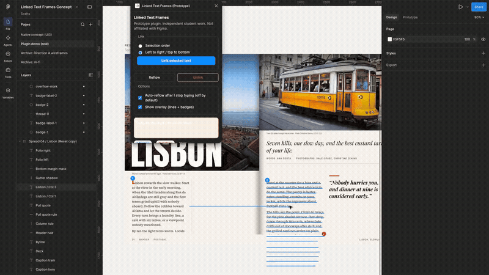
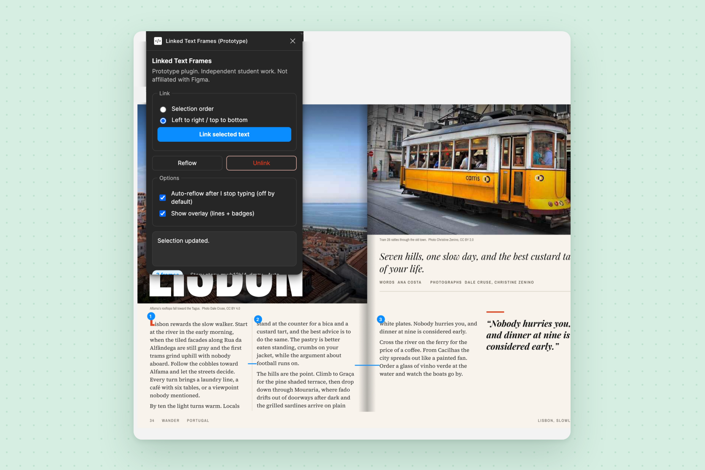

# Linked Text Frames

A development Figma plugin, written as an independent student prototype by Immanuel Mensah and not affiliated with Figma, that links text layers into a story and reflows the copy across fixed-size frames.



## What it does

- Links two or more text layers into one story, in selection order or left to right / top to bottom.
- Stores the story on the document with `sharedPluginData`, and stores `storyId` and `order` on each text node with `pluginData`.
- Reflows the combined copy into the fixed-size frames. The body style is the style that covers the most characters, never the first character. Styled runs (font, size, line height, letter spacing, case, and fill) are reapplied by character offset, so a styled initial cap stays on that letter and does not spread.
- Measures fit with one off-canvas probe text node per reflow and a binary search on character count. Splits stay on word boundaries. A column will not open with a one or two word paragraph tail when that tail still fits in the previous frame. The whitespace a split swallows (a space or a paragraph break) is stored on the node so the next reflow does not insert a false paragraph break mid sentence.
- After writing a frame, measures that frame and pulls the last word into the next frame if it does not fit. A 2 px safety margin is kept.
- Draws a locked overlay of connectors and numbered badges. Toggle **Show overlay** to hide or show it. When the last frame still overflows, the overlay adds a red plus on that frame and the UI shows an Overflow warning.
- **Unlink** clears membership for the selected story and removes the overlay.
- Auto-reflow is off by default. When **Auto-reflow after I stop typing** is on, the plugin waits 1.2 seconds after the last edit, then reflows. It reacts to real text edits, resizes, and deletes of linked frames, and it ignores its own writes by comparing content. If the text changes during a reflow, that pass is thrown away and retried from the new text.
- If a linked frame is deleted, the next reflow drops it from the chain and flows its text into the remaining frames. Undo of that delete puts the frame back in its original place and reflows again, without duplicating the old text.
- Selecting a frame named Box A, Box B, or Box C uses its single text child. Layers named Label A, Label B, or Label C are ignored. Directly selected text layers are linked too.
- Empty frames are allowed. Fonts used by the story are loaded before writing. If a font is missing, the plugin falls back to Inter.
- The plugin does not use the network (`allowedDomains` is `none`).



To link frames: create two or more text layers (fixed box sizes work best), select them, choose an order, and click **Link selected text**. Click **Reflow** after you resize a box or edit the copy.

## Install and run

1. Open Figma desktop. A plugin imported from a local manifest needs the desktop app.
2. Open a design file.
3. Choose **Plugins > Development > Import plugin from manifest...**
4. Select `manifest.json` in this folder.
5. Run **Plugins > Development > Linked Text Frames (Prototype)**.

After you replace `code.js`, close the plugin and run it again so Figma loads the new file.

## Build

Figma loads `code.js` (`"main": "code.js"` in `manifest.json`). That file is committed. Rebuild it from `code.ts` after source changes:

```bash
npm install
npm run build
```

`npm run build` runs `tsc -p tsconfig.json` and writes `code.js` beside `code.ts`. `npm run watch` compiles again on each change.

## Known limitations

- This is not native InDesign-style live threading. The Plugin API cannot add real in/out ports, and it cannot keep text flowing while you type the way a built-in feature would.
- Measurement is approximate. Binary search and word-boundary snapping can leave awkward breaks, especially with mixed fonts, custom line heights, or nested auto layout.
- Overlay lines are simple rectangles (horizontal bias, a basic elbow). They are not true vector connectors, and they can drift if parents move until the next reflow.
- Auto-reflow can feel laggy on long stories, because each fit step measures text on a probe node.
- `documentAccess` is `dynamic-page`. On startup the plugin loads pages with `loadAllPagesAsync`.
- No network access (`allowedDomains` is `none`).
- Undo treats plugin writes like any other edit.

Case study: [Linked Text Frames](https://portfolio-tutu-fcd6.vercel.app/work/linked-text-frames)
